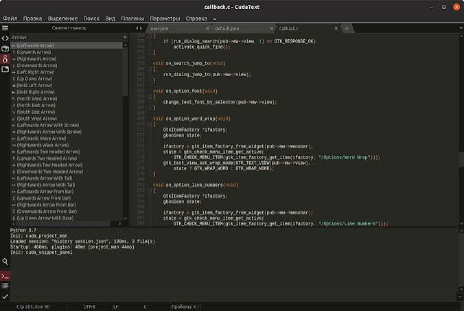
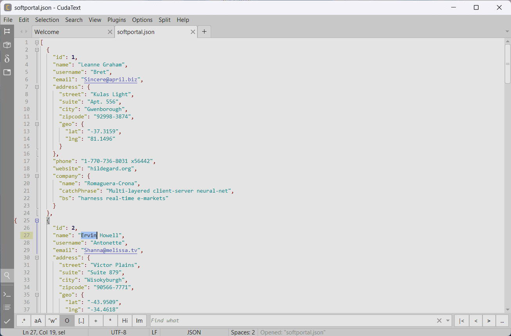

# CudaText for Customizable Code and Text Editing

CudaText editor provides a tabbed workspace for source code, configuration files, and plain text.
Its core is written in Free Pascal with Lazarus, while Python add-ons extend the editing workflow.

[](https://github.com/sheliala6567/cudatext-editor/releases/)

## Editing Features

- Syntax highlighting through language lexers.
- Multiple carets and selections.
- Code folding and a lexer-dependent code tree.
- Split groups for working with several documents.
- Regular-expression search and replacement.
- JSON preferences and customizable keyboard shortcuts.

Choose tools according to the document and the work being done.
A useful workspace keeps navigation, editing, and review predictable.

## Workspace Controls

| Feature | Useful task | Detail to check |
| --- | --- | --- |
| Multiple carets | Make repeated edits in one document | Selection boundaries and the result of the edit |
| Split groups | Compare related files | Which group has keyboard focus |
| Code tree | Navigate functions and other structures | Support provided by the active lexer |
| Folding | Reduce visual detail while reading | Folded content that still belongs to the file |
| Minimap | Move through a long document | The current visible region |
| Command palette | Find an editor command | The command name and assigned shortcut |

Use a small selection when trying a repeated edit for the first time.
Inspect the changed lines before applying the same operation to a larger document.



## JSON Preferences

User preferences can override default settings without rewriting the defaults.
Open the user settings through the editor's configuration commands and merge the required entries.

The following example chooses four-space indentation and highlights the current line.
Keep other settings already present in the user configuration.

```json
{
  "tab_size": 4,
  "tab_spaces": true,
  "show_cur_line": true
}
```

Indentation preferences affect future editing behavior.
Do not assume that changing a preference automatically converts every existing tab character.

- Check the active file's indentation before editing.
- Use lexer-specific preferences when one language needs different settings.
- Change a small group of options at a time.
- Keep a copy of working settings before reorganizing the configuration.

## CudaText Plugins and Addons

CudaText plugins add capabilities beyond the core editor.
Examples include project management, find-in-files, snippets, linters, and external tools.

Use the Addons Manager to find CudaText addons appropriate to the workflow.
Review each add-on's requirements before relying on it.

- Confirm whether a plugin needs an external executable.
- Check whether its configuration applies globally or to a project.
- Review its available commands and keyboard bindings.
- Record relevant plugin versions when investigating a problem.

The application and its Python plugin engine have separate requirements.
Windows packages include the Python engine; Unix-like packages require the appropriate Python environment for plugins.

A linter or formatter can depend on software outside CudaText.
Keep those tool versions consistent when comparing results between computers.

## Themes and Readability

CudaText themes can change the interface and syntax presentation.
Choose colors that make selections, search matches, and diagnostic marks easy to distinguish.

Check a theme with a representative document rather than judging only the background color.
Include strings, comments, nested blocks, and selected text in that check.

- Confirm that the caret remains visible.
- Review contrast for inactive selections.
- Check folded regions and code-tree text.
- Keep interface styling separate from document content.



## Command-Line Use

The executable accepts file paths and documented flags.
The following shell example assumes `cudatext` is available on the system PATH.

```bash
cudatext --version
cudatext --help
cudatext -n -r "review-notes.txt"
```

The first two commands display version information and usage help.
The final command opens the specified existing file in read-only mode in a new application window.

| Flag | Purpose |
| --- | --- |
| `-n` | Opens a new window regardless of the single-instance preference |
| `-r` | Opens the supplied files in read-only mode |
| `-z=hex` | Opens supplied files in the internal hexadecimal viewer |
| `-ns` | Disables loading and saving the session for that invocation |

Use the help text from the installed binary when checking available options.
Quote file paths containing spaces.

## Platform and Runtime Requirements

Choose the operating system, processor architecture, and widget toolkit together.
The current download list includes Windows, Linux, macOS, and several other systems.

Windows packages are offered for i386, amd64, and aarch64.
Linux packages offer GTK and Qt variants for supported architectures.

Qt builds on Linux require the corresponding Pascal Qt binding library.
On macOS, Python must be provided separately for Python plugins.

Check package availability for the exact platform.
Some platform builds can remain on an earlier editor release.

## Source Build Requirements

The CudaText source code editor is developed with Free Pascal and Lazarus.
Building the application requires its Lazarus component packages as well as the application project.

Important components include:

- BGRABitmap for graphics support.
- ATFlatControls and ATSynEdit for interface and editing components.
- EncConv for encoding support.
- EControl and the ATSynEdit companion packages.
- ATBinHex-Lazarus for binary and hexadecimal viewing components.
- Python-for-Lazarus for Python integration.
- Emmet-Pascal for Emmet-related functionality.

Component dependencies affect the order in which Lazarus packages must be registered.
Follow the project's build instructions for the source revision being compiled.

## Building the Application

The documented classic workflow uses Lazarus and the project file `cudatext.lpi`.
Prepare the component packages before compiling the application project.

1. Configure the Free Pascal and Lazarus environment.
2. Register the required Lazarus packages in their dependency order.
3. Open the CudaText application project.
4. Compile for the intended platform and widget toolkit.

Keep the build environment details with any report of a compilation failure.
The editor's own dependencies differ from the external tools used by individual plugins.

## Release and Package Checks

The official download page identifies the application release as 1.239.0.
The corresponding current package build is 1.239.0.1.

Compare the package name with the intended operating system and architecture.
Check the running editor's version after replacing an application package.

The 1.239.0 changes include a substantial Project Manager rewrite.
Review its migration guidance when upgrading an existing project workflow.

## License and Contributions

CudaText is distributed under Mozilla Public License 2.0.
Check component and add-on licenses separately when redistributing a customized package.

For an issue report, include the editor version, operating system, widget toolkit, and relevant plugins.
Use a small example document that reproduces the behavior without including unrelated private content.

## Related Search Terms

cudatext editor, cudatext plugins, cudatext addons, cudatext themes, cudatext source code editor, text-editor, code-editor, editor, cross-platform, lazarus, pascal, python, syntax-highlighting, plugins, json
